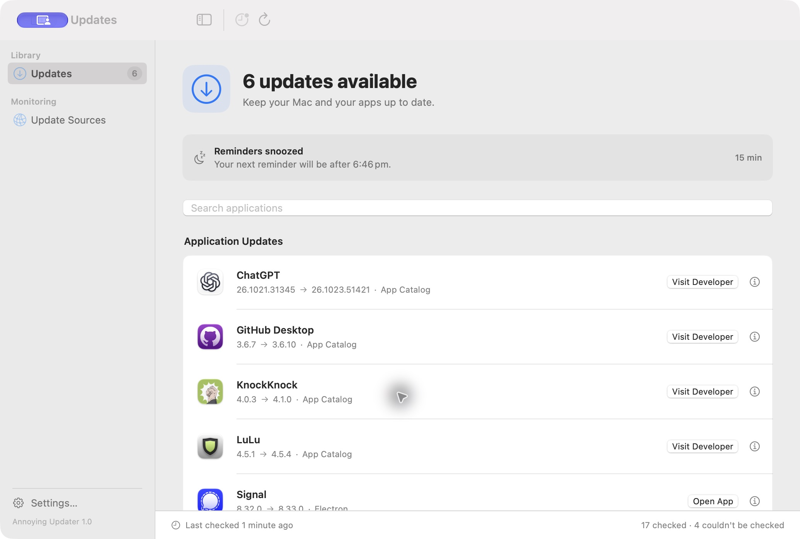
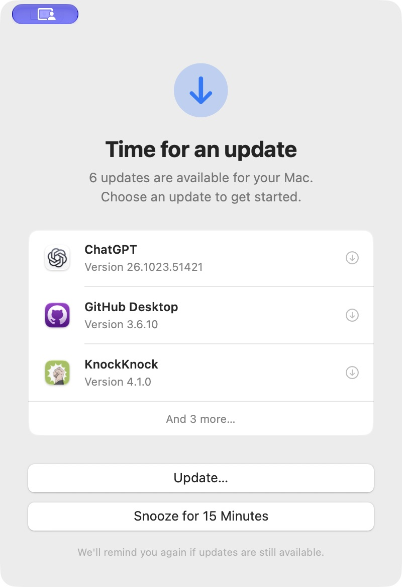

# Annoying Updater

### A little persistence. A more up-to-date Mac.

AI agents are finding vulnerabilities at lightning speed. Keeping software updated matters more than ever.

**Annoying Updater bugs you every 15 minutes until the updates it finds on your Mac are installed.** A native macOS app with one job: making “I'll update it later” a little harder to forget.

[**Download for macOS →**](https://github.com/elliottjonestw/annoyingupdater/releases/latest)

macOS 14 or later · Apple silicon and Intel



## Update. Snooze. Repeat.

When an update is available, Annoying Updater brings a reminder to the front. Update now, or snooze for 15 minutes. If updates remain, it'll be back.

<p align="center">
  
</p>

- **Finds updates automatically.** Checks macOS, App Store apps, developer feeds, Homebrew, public app catalogs, and more. No per-app setup.
- **Checks command-line tools too.** Monitors Homebrew formulae and global npm packages, including standard and nvm Node installations. Copy an update command to run in Terminal when you're ready.
- **Finds portable apps.** Discovers apps in Downloads, running apps, and connected drives, using Spotlight where available. Locations are shown so you can identify each copy.
- **Checks apps from Finder.** Select apps and choose **Services → Check with Annoying Updater** to see their results.
- **Can watch browser extensions.** An optional companion connects Chromium and Firefox profiles and checks supported public store versions. [Preview setup and coverage](BrowserCompanion/README.md).
- **Keeps everything in one place.** See available updates first, apps that need a manual check next, and up-to-date software last.
- **Shows what an update changes.** When published notes are available, **What’s New** shows releases between your installed version and the selected update, newest first. Read just the target release, load older history, or open the original notes. Missing history and sources that provide only the latest notes are clearly labelled.
- **Shows how long updates have been waiting.** Uses the earliest newer dated publisher release it can find, labelled “Outdated for at least …”. When publication dates aren’t available, “Detected … ago” uses local tracking instead. Dates and sources are explained in the update’s details.
- **Remembers what changed.** Local update history records installed version and build changes, including updates made outside Annoying Updater. Pending updates show when they were first detected.
- **Helps you finish the job.** Installs supported Homebrew updates or takes you to the app, App Store, system updater, or developer's site.
- **Starts with your Mac.** Open at login is on by default. Close the window and it keeps watch from the menu bar.
- **Keeps itself updated.** Downloads and verifies its own updates from GitHub, then installs them when you quit or choose Install and Relaunch.

Some apps don't expose a reliable way to check for updates. Annoying Updater clearly marks those as **Couldn't check** or **Couldn't verify**.

## See what changed

History gives you a searchable timeline of installed version and build changes, including updates made by other apps or installed manually. Open an entry to see the before and after, when the change was detected, and when its update was first detected, if known.

Tracking starts with your first scan. History stays on your Mac, and you can clear it at any time.

## Check from Finder

In Finder, select one or more apps and choose **Services → Check with Annoying Updater**. Install Annoying Updater in Applications first. If the service is hidden, enable it in System Settings → Keyboard → Keyboard Shortcuts → Services. Selected apps are checked with the same automatic sources and remain monitored when accessible.

## Install

1. Download the latest `.dmg` from [Releases](https://github.com/elliottjonestw/annoyingupdater/releases/latest).
2. Open it and drag **Annoying Updater** to **Applications**.
3. Eject the disk image and open the app.

The app isn't Developer ID signed or notarized yet. If macOS blocks it, follow [Apple's instructions to open an app from an unidentified developer](https://support.apple.com/en-us/102445).

## Private by design

No account. No Annoying Updater server. App matching happens on your Mac; your installed-app inventory isn't uploaded to the public app catalogs. Update checks contact Apple, the catalogs, and the relevant developers or GitHub. If you connect the optional browser companion, extension checks send identifiers and, when needed, installed/browser versions to Google or Mozilla; browsing history, tabs, cookies, and passwords are never accessed.

## Build it yourself

With a Swift 6 toolchain and macOS SDK:

```sh
scripts/build.sh
open "build/Annoying Updater.app"
```

Run `scripts/test.sh` for Swift tests and `node --test BrowserCompanion/bridge.test.cjs` for companion tests. To create a universal disk image, run `scripts/build.sh release universal`, then `scripts/package.sh`. The [release workflow](.github/workflows/release.yml) builds and publishes the version in `VERSION` when its matching tag (such as `v1.3`) is pushed.

All rights reserved. See [LICENSE](LICENSE). Third-party licenses are included in the app and in [ThirdPartyNotices.txt](Resources/ThirdPartyNotices.txt).
